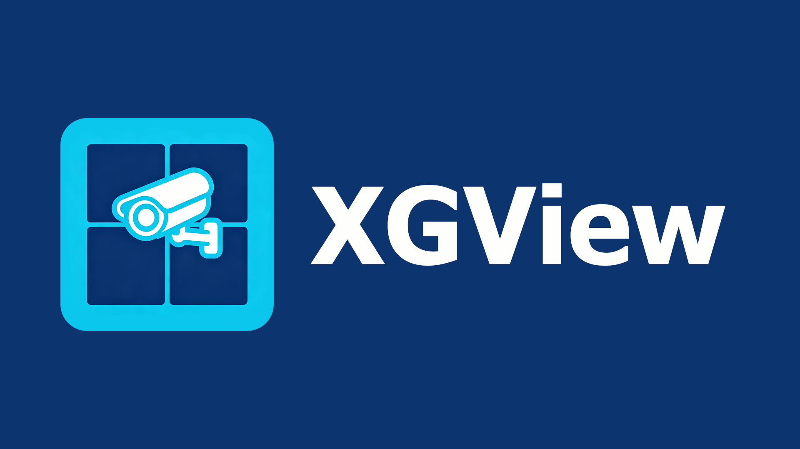
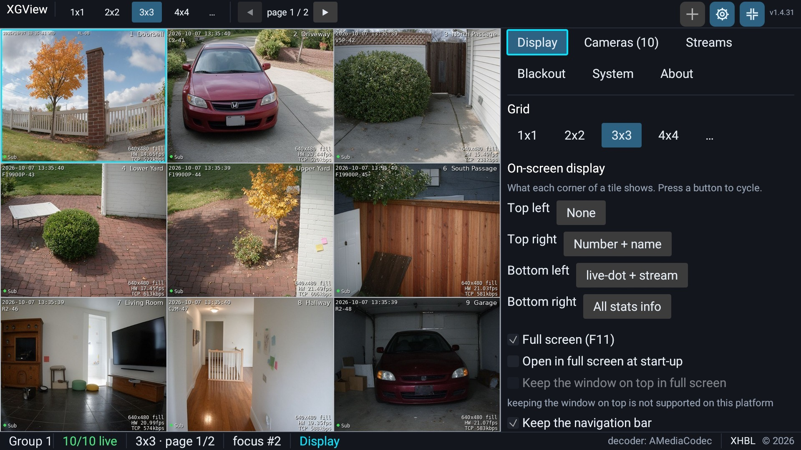
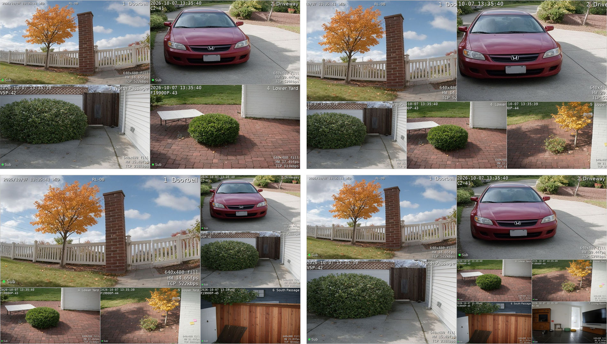
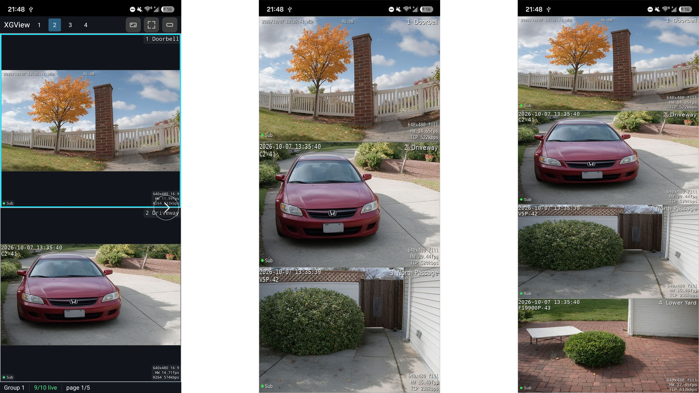
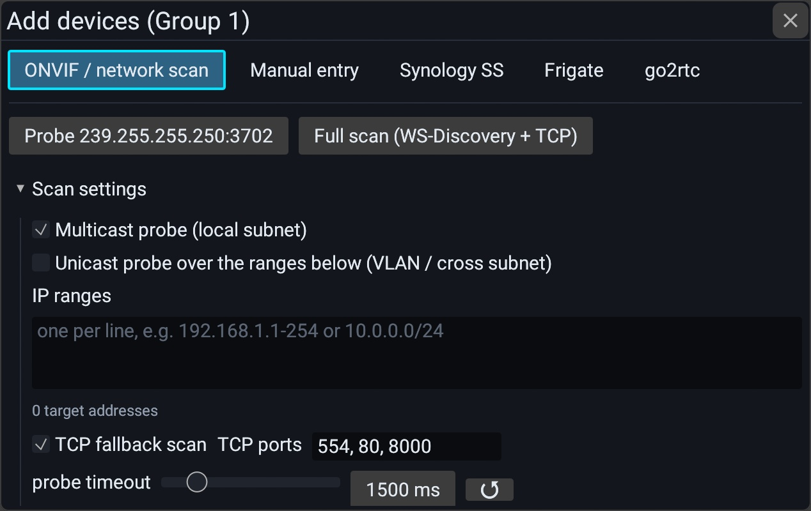

# XGView - A grid viewer for surveillance cameras

**A lightweight, production-grade camera wall written in Rust.** It turns one
screen into a live grid of your IP cameras - 1x1 up to 4x4, nine mixed layouts
of up to 13 cells, or four stacked grids when the screen stands upright, with
paging beyond that. No cloud, no account, MIT licensed.

- **One program for every screen.** Android TV boxes and wall-mounted
  displays, phones and tablets - upright or on their side - and Windows, Linux
  or macOS mini PCs for a kiosk or control-room wall. Driven by a TV remote's
  DPAD and `BACK`, a finger or a mouse; H.264 and H.265 decode on the GPU where
  the machine has one.
- **One wall for every camera you have.** Import a whole server from Frigate,
  go2rtc or Synology Surveillance Station, or add ONVIF, RTSP, MJPEG and
  WebSocket streams directly.
- **Cheap on the network and the CPU.** The grid pulls sub streams and
  suspends the pages you are not looking at - sockets and decoders alike; only
  a magnified tile pulls its main stream, or one pinned to it from the Cameras
  tab.
- **Built to stay up.** Cameras reconnect on their own with configurable
  backoff, the wall can start at boot and run supervised, and a schedule can
  blank the screen and park every channel at night.

**Download:** [latest release](../../releases/latest)

| Platform                           | File                                                                                                                |
| ---------------------------------- | ------------------------------------------------------------------------------------------------------------------- |
| Android / Android TV (arm64, 8.1+) | [`xgview-1.5.60-android-arm64-v8a.apk`](../../releases/download/xgview-v1.5.60/xgview-1.5.60-android-arm64-v8a.apk) |
| Windows x64                        | [`xgview-1.5.60-windows-x86_64.zip`](../../releases/download/xgview-v1.5.60/xgview-1.5.60-windows-x86_64.zip)       |
| Linux x64                          | [`xgview-1.5.60-linux-x86_64.tar.gz`](../../releases/download/xgview-v1.5.60/xgview-1.5.60-linux-x86_64.tar.gz)     |
| macOS (universal)                  | [`xgview-1.5.60-macos-universal.zip`](../../releases/download/xgview-v1.5.60/xgview-1.5.60-macos-universal.zip)     |

**Note: This is a personal project, shared as-is, with no warranty.** It was developed with **AI assistance** under my direction and testing; please review the code before using
it in sensitive setups.


*The wall with the settings panel open.*


*Multiple layouts with full screen, from 1 cell up to 16.*


*Portrait layout supported on a phone / tablet.*


*Multi-source camera ingestion made easy.*

***

## Table of contents

- [Why XGView](#why-xgview)
- [Features](#features)
- [Supported platforms](#supported-platforms)
  - [Android: what the device needs](#android-what-the-device-needs)
  - [Windows: what the device needs](#windows-what-the-device-needs)
  - [Linux: a minimal kiosk machine](#linux-a-minimal-kiosk-machine)
  - [macOS: what the device needs](#macos-what-the-device-needs)
- [Getting started](#getting-started)
- [Usage](#usage)
  - [The wall at a glance](#the-wall-at-a-glance)
  - [Grid layouts and paging](#grid-layouts-and-paging)
  - [Portrait mode](#portrait-mode)
  - [Zooming a camera](#zooming-a-camera)
  - [Keyboard and remote control](#keyboard-and-remote-control)
    - [Remote control (DPAD)](#remote-control-dpad)
    - [Touch screen](#touch-screen)
  - [Settings panel](#settings-panel)
  - [Adding cameras](#adding-cameras)
  - [Camera groups](#camera-groups)
  - [Blackout schedule](#blackout-schedule)
  - [Keep awake](#keep-awake)
  - [Stay on top in full screen](#stay-on-top-in-full-screen)
  - [One instance per configuration](#one-instance-per-configuration)
  - [Start on boot](#start-on-boot)
  - [Keep it running](#keep-it-running)
  - [Language](#language)
  - [Command line](#command-line)
  - [Troubleshooting](#troubleshooting)
- [License](#license)
- [Contact](#contact)

***

## Why XGView

- **Runs unattended.** Cameras reconnect on their own with configurable backoff,
  the machine can be held awake, and the wall can start at boot - a box in a
  closet keeps showing pictures for weeks without anyone touching it.
- **Cheap on bandwidth and CPU.** The grid pulls each camera's cheap sub stream;
  only a magnified camera switches to the main stream - or a camera pinned to it
  from its row in the Cameras tab, for a tile watched closely while the wall stays
  a wall; channels on a page you are not looking at are suspended, sockets and
  decoders alike.
- **Remote-first and touch-first.** Everything from navigation to the settings
  panel is reachable with five DPAD keys, a finger or a mouse - no keyboard
  required.
- **Direct, no cloud.** XGView talks to your cameras over ONVIF and RTSP itself.
  No account, no subscription, no vendor service in the middle; the whole setup
  is one `xgvconfig.json` you can copy between machines. Cameras are brought in
  from wherever they already live: an ONVIF / network scan that reaches across
  subnets, a hand-typed RTSP, MJPEG or WebSocket url, or a whole server in one
  go from Synology Surveillance Station, Frigate or go2rtc - every import taking
  each camera's main and sub stream, and both of its addresses where it has a
  WebSocket one.
- **Self-contained.** A single binary with its decoder and language packs shipped
  alongside it, on Windows, Linux and Android.

## Features

| Area                | What it does                                                                                                                                                                                                                                                                                                                                                                     |
| ------------------- | -------------------------------------------------------------------------------------------------------------------------------------------------------------------------------------------------------------------------------------------------------------------------------------------------------------------------------------------------------------------------------- |
| Grid layouts        | 1x1, 2x2, 3x3 and 4x4 as direct buttons, plus nine mixed layouts (2, 3, 5, 6, 7, 8, 10, 12, 13 cells) behind a graphical picker; switchable at runtime with the digit keys or the toolbar. Held upright, the four stacked grids (1x1 to 1x4) stand in their place                                                                                                                |
| Portrait            | Where the device can stand upright - a phone or a tablet, not a television - the wall turns: four stacked grids, the on-screen display rotated with the video, a picture fit of its own per camera, and the page arrows floated at the screen edges. The settings panel is reached in landscape, and the choice is remembered across restarts - the wall comes up already turned |
| Pagination          | Channels beyond the grid's capacity are paged; swipe, `PageUp` / `PageDown` or the toolbar slides between pages                                                                                                                                                                                                                                                                  |
| Focus navigation    | A 2 px cyan focus ring walks the tiles with the arrow keys or a TV remote's DPAD; the sideways arrows turn the page at the left and right edges, and the vertical ones stop at the top and bottom, where the wall hands the keys to the bars. It is the remote's cursor: a press of the mouse or a finger does not move it, and it is drawn only while that cursor is being handled - a key that walks it, or a click on a tile, brings it back and it goes again eight seconds later, on its own clock rather than the bars'. A page turn is never one of those: the page keys, the toolbar's page arrows and a swipe all move the picture rather than the ring, so all three behave alike - and a page turn, like a layout that moves the cursor under the viewer, takes a ring that is showing down with it. The bars are the other thing it has to do with: it is taken down as they hide and brought back as they appear, and a wall driven in full screen with the bars away keeps its ring |
| Temporary zoom      | Double click, `DPAD_CENTER`, `Enter` or `Space` magnifies a viewport to 1x1, and a double press or `Esc` / `BACK` puts it back. The magnified picture carries a floating bar of its own along the bottom, laid out on the picture's own frame: the picture fit, the sound switch, the microphone where the camera takes a talk-back, and - held upright - the quarter turn. A quick tap anywhere on the picture brings the bar up and another puts it away; a press that lingers, a drag that does not turn the page and a pinch leave it as it was, and a double press is still the way back to the grid. A call in progress makes the bar modal: a press on the picture leaves it where it is, `Esc` / `BACK` ends the call before it puts the bar away, and a panel opening over the wall leaves the strip on screen. Upright and not turned, the bar is up from the start and stays; turned, or in landscape, it is asked for. The magnified view has a picture fit of its own, set from that bar and remembered per camera; the wall's landscape and portrait fits are untouched. Upright, the picture is drawn as the camera sends it - a landscape stream keeps its letterbox - until the quarter turn fills the screen, and that choice is one for the whole configuration |
| Audio               | The magnified camera's sound plays through the machine's own output, off until the bar's speaker switch turns it on. Which output that is can be chosen in the settings - a machine with one sound card needs nothing, a kiosk with a USB dongle and a television on HDMI does, because the system's default is not always the one with a speaker behind it - and the microphone is chosen the same way. Where a camera offers a back channel, that bar also carries a microphone: pressing it opens a session of its own - the camera's `sendonly` track set up alone, one G.711 (PCMU / PCMA) packet every 20 ms - and the strip becomes one red handset while the call is up, which ends it, as does `Esc` / `BACK` or leaving the view. The picture's session never asks for a back channel and never holds the camera's speaker open: whether a camera can be talked to is asked once, on a short connection of its own, and the answer is remembered by address. A camera that will not take a call of its own gets the older arrangement instead - the back channel carried by the picture's session. On Android the call is full duplex: the platform's echo canceller is attached to the capture and the camera's sound is played on the voice-communication path through the speaker, which is the reference signal the canceller needs. Elsewhere there is no canceller, and a call is full duplex too unless the Audio tab's switch makes it half duplex - the camera's sound muted while the microphone is open - which is what a machine with the microphone beside its speaker wants, because a speaker playing into its own microphone howls. Hang up to listen again |
| Stream switching    | Every layout pulls the cheap sub stream (360P / 480P), the 1x1 grid included; a tile can be pinned to its main stream (1080P / 4K) from its row in Cameras, for the camera worth watching closely while the wall stays a wall - and a magnified viewport always pulls the main stream |
| Seamless transition | The frame a tile was showing is held until the new stream delivers its first keyframe - no black or green frames                                                                                                                                                                                                                                                                 |
| Suspend             | Channels on a non-visible page are suspended to save bandwidth, CPU and decoder handles                                                                                                                                                                                                                                                                                          |
| Reconnection        | Exponential-backoff self-healing with a non-blocking "reconnecting…" overlay; the backoff shape and the handshake timeout are configurable and reach channels already running                                                                                                                                                                                                    |
| Decoding            | H.264 and H.265 on the GPU where the machine offers a decoder (Direct3D 11 Video / CUDA on Windows, VAAPI / CUDA on Linux, VideoToolbox on macOS, `AMediaCodec` on Android) and on the CPU elsewhere - Android falling back to OpenH264 by itself for an H.264 stream its own decoder will not take; MJPEG on the CPU everywhere. Each tile shows `HW` or `SW`                   |
| Codecs              | H.264, H.265 (HEVC) and MJPEG are decoded and displayed. H.265 uses the platform's decoder (VideoToolbox on macOS, `AMediaCodec` on Android) or FFmpeg on the desktop, on the GPU or the CPU. Android has no software HEVC, so a stream a device's own decoder will not take shows no picture - use its H.264 sub stream there                                                   |
| Transports          | RTSP over TCP (interleaved, the default) or UDP, chosen per camera; HTTP / HTTPS MJPEG (`multipart/x-mixed-replace`) cameras are supported too. A Frigate or go2rtc camera also carries an MSE (fMP4 over WebSocket) address, which the connection switch can prefer or fall back to when RTSP cannot be reached                                                                 |
| On-screen display   | Each tile corner independently shows one of: none, name, number + name, live-dot + stream, codec + bitrate, decoder + fps, resolution + aspect ratio, transport + url, date + time, or one of four **combined** slots, each stacking the items you pick for it                                                                                                                   |
| Power management    | Keeps the machine awake and/or the screen on while the wall is up (`SetThreadExecutionState` on Windows, `caffeinate` on macOS, `systemd-inhibit` + the desktop's D-Bus inhibit on Linux, `WakeLock` + `FLAG_KEEP_SCREEN_ON` on Android); both switches default on                                                                                                               |
| Blackout            | Scheduled periods, per weekday, in which the wall blanks itself and parks every channel - sockets closed, decoders dropped; input brings it back for a chosen number of minutes                                                                                                                                                                                                  |
| Language            | English, Chinese, or any language added as an external `.ftl` pack; a partial pack falls back to English key by key                                                                                                                                                                                                                                                              |
| Toolbar             | An on-screen bar for the layout, paging, full screen, settings and adding cameras, plus the orientation switch where the device can stand upright; usable with a mouse, touch or a remote                                                                                                                                                                                        |
| Discovery           | ONVIF WS-Discovery multicast probe, cross-subnet unicast scan, and a TCP 554/80/8000 fallback probe, followed by `GetProfiles` / `GetStreamUri`                                                                                                                                                                                                                                  |
| Server import       | Import every camera in one go from Synology Surveillance Station (`SYNO.API.Auth` + `SYNO.SurveillanceStation.Camera`), Frigate (its API, each camera's main and sub stream paired by measured resolution) or a standalone go2rtc (`/api/streams`)                                                                                                                               |
| Cameras             | Add, edit, reorder and remove cameras; a per-camera display aspect, held separately for landscape and portrait, a magnified-view fit of its own (set from that view's bar), a connection switch - `AUTO`/`RTSP`/`MSE` where a WebSocket address exists, `TCP`/`UDP` otherwise - and a stream switch that pins that camera's tile to its main stream |
| Groups              | Named camera groups, each with its own cameras, a grid and paging of its own per orientation, switched from the settings; the same camera may sit in more than one                                                                                                                                                                                                               |
| Start on boot       | A Windows `HKCU\...\Run` registry entry (or a scheduled task), an XDG autostart entry on Linux, a LaunchAgent on macOS, and an Android `BOOT_COMPLETED` receiver                                                                                                                                                                                                                 |
| Configuration       | Everything persisted to a cross-platform `xgvconfig.json`, with a passphrase-sealed export and an import that reads either form                                                                                                                                                                                                                                                  |

## Supported platforms

| Platform                | Typical device          | Decoding                                                     |
| ----------------------- | ----------------------- | ------------------------------------------------------------ |
| **Android** (arm64-v8a) | TV box, phone, tablet   | `AMediaCodec` - hardware, falling back to OpenH264 for H.264 |
| **Windows** x64         | mini PC, kiosk, desktop | Direct3D 11 Video or CUDA - hardware, with a CPU fallback    |
| **Linux** x64           | desktop, mini PC        | VAAPI or CUDA - hardware, with a CPU fallback                |
| **macOS** (universal)   | desktop, laptop         | VideoToolbox - hardware, with a CPU fallback                 |

Hardware decoding covers H.264 and H.265; MJPEG is always decoded on the CPU. It
needs a GPU that offers VAAPI or CUDA, which a desktop with an NVIDIA, Intel or
AMD graphics does; a machine that offers neither decodes on the CPU, where the
wall still runs - comfortable for a grid of sub streams, and heavier once it
starts pulling main streams. macOS decodes through VideoToolbox, which is part
of the system, and only where the Mac really has a decoder for the codec - which
it is asked about up front, so a GPU older than hardware HEVC shows `SW` on an
H.265 tile rather than a hardware badge it has not earned. Android decodes
through `AMediaCodec` - with H.264 falling back to OpenH264 on the CPU when the
platform's decoders will not have the stream. A tile whose corner is set to the
frame-rate item shows `HW` or `SW`, so you can see at a glance which path a
camera is on.

### Android: what the device needs

- **A 64-bit ARM device** (`arm64-v8a`) - the only ABI the APK is built for.
- **Android 8.1 or newer.** The APK declares `minSdkVersion 27`, so an older
  device refuses it with "there was a problem parsing the package" instead of
  installing it.
- **A GPU with Vulkan 1.1, or OpenGL ES 3.2 /** **`GL_KHR_debug`.** XGView draws
  through wgpu, which takes the **Vulkan** backend wherever the device offers one
  it can use. A device with **no Vulkan at all, or only Vulkan 1.0** (Adreno on
  Android 8.x) is sent to the **OpenGL ES** backend instead - and that is decided
  before the renderer is built, so such a device comes up on GL from its first
  launch rather than failing once and recovering on the next.
- **H.264 and H.265 are decoded in hardware** (`AMediaCodec`) where the chip
  offers it - with a software fallback for H.264 only, since there is none for
  HEVC; MJPEG is always decoded on the CPU. A tile whose corner shows the
  frame-rate item says `HW` or `SW`.

Two kinds of device fall below that floor and are refused rather than half run: a
box that offers only **OpenGL ES 2.0** - an Amlogic S905 / Mali-450 on its stock
Android 9, for instance - has no adapter to draw with, and one whose OpenGL ES
3.x driver lacks `GL_KHR_debug` cannot be given the resource labels the GL
backend asks for. In both cases the viewer says so in its log and closes.

If a launch does fail before the renderer comes up, the failure is written to the
log and the app brings itself back on the GL backend a few seconds later - no
remote needed. A panic later in a run restarts the viewer on the backend that had
plainly been working, rather than changing it. Restarts are capped at three in
ten minutes, and a device that can draw on neither backend is left closed instead
of restarted in a loop. On Android 10 and newer the restart can be refused as a
background start unless XGView may *display over other apps* - the same permission
[start on boot](#start-on-boot) uses.

### Windows: what the device needs

- **64-bit Windows 10 or newer.** The package is built for x64 alone; there is
  no 32-bit or ARM build.
- **Nothing to install.** Unpack the zip anywhere and run `xgview.exe` - the
  FFmpeg runtime it links against travels beside it in the same folder. Delete
  the folder to uninstall.
- **Direct3D 12 for the wall itself.** A machine whose display adapter stops at
  Direct3D 11 still runs: the wall is drawn through WARP, Windows' software
  rasteriser, and says so on the first frame - at a frame rate well below what
  a GPU gives.
- **H.264 and H.265 are decoded in hardware** through Direct3D 11 Video or CUDA
  where the driver offers it, falling back to the CPU otherwise; MJPEG is
  always decoded on the CPU. A tile whose corner shows the frame-rate item says
  `HW` or `SW`.

### Linux: a minimal kiosk machine

A box that boots straight into the wall needs no desktop environment, but it does
need a display server and a session: the viewer draws through a window and has no
mode that paints the display directly. On Debian, what that comes to:

- **A display server** - Xorg or Wayland - and a *window manager*. Full screen,
  staying on top, and a second launch coming forward are all requests made to a
  window manager, and none of them happens without one. `matchbox-window-manager`,
  `openbox` or `i3` are a few megabytes; a kiosk compositor such as `cage` fills
  both roles at once.
- **An automatic logon.** Xorg takes the display through logind and needs an
  active session, so the arrangement is a logon on a virtual console that asks for
  no password. Running Xorg as root is a path its drivers no longer support.
- **The viewer started from** **`~/.xinitrc`**, because nothing on such a box reads
  the XDG autostart entry:
  ```sh
  xset -dpms s off &                      # see the last point below
  exec xgview --fullscreen --supervise    # and it comes back if it dies
  ```
- **Packages**, on top of the window manager itself. The window system:
  `libx11-6 libxcb1 libxcursor1 libxrandr2 libxi6 libxkbcommon-x11-0` - `ldd
  xgview` will not name those, they are loaded as they are needed. Text:
  `fontconfig` and at least one face, `fonts-dejavu-core`. Renderer:
  `libvulkan1 mesa-vulkan-drivers`, or the GL fallback `libegl1 libgl1-mesa-dri`.
  Sessions: `libdrm2` and `systemd` for logind. Sound: `libasound2`, which the
  audio path links - without it the viewer does not start, and a box with no
  sound server has the picture and no sound rather than the other way round. The
  decoders need nothing extra - FFmpeg and libva travel in the package.
- **The screen.** [Keep awake](#keep-awake) cannot help here: there is no screen
  saver and no power service to inhibit over the session bus, and a bare Xorg may
  not have one at all. The blanking is the X server's own DPMS, so it is turned off
  at the X level - the `xset -dpms s off` above, or `Option "DPMS" "false"` in
  `xorg.conf`. Sleep itself is still inhibited the usual way, through logind.

A step-by-step walkthrough for Debian 13 - from a minimal install to a
full-screen wall under systemd, plus Docker for Frigate and Home Assistant - is
in [docs/DEBIAN-KIOSK.md](docs/DEBIAN-KIOSK.md), with a one-shot
[`scripts/debian-kiosk.sh`](scripts/debian-kiosk.sh) for the setup itself.

### macOS: what the device needs

- **macOS 11 (Big Sur) or newer**, on Intel or Apple silicon: the download is one
  universal `.app`, so the same file runs natively on either.
- **Nothing to install.** Drag it to *Applications*, or run it from wherever it
  was unpacked; delete it to uninstall. The configuration in `~/.config/xgview`
  is left alone either way.
- **It is signed ad-hoc, not notarised.** A copy built here or moved by hand
  opens straight away. One that came over the network is quarantined by
  Gatekeeper and refuses until it is allowed in *System Settings → Privacy &
  Security*, the app not carrying a Developer ID.

***

## Getting started

XGView is a GUI: start `xgview` (or double-click `xgview.exe`) and the wall comes
up with whatever cameras are already in its configuration.

1. **Get the build.** Windows ships as a zip you unpack anywhere; Linux as a
   self-contained `tar.gz` that comes with its own `install.sh`; macOS as a
   signed universal `.app` inside a zip; Android as a signed APK; or build from
   source. See [docs/CONFIG.md](docs/CONFIG.md).
2. **Add cameras.** On the first run the grid is empty - press `F2` to discover
   cameras on the network, or add one by hand.
3. **Make it yours.** Press `F1` for the settings panel: layout, OSD, language,
   reconnect timings, the blackout schedule and start on boot.

Nothing is installed and nothing is registered behind your back; the Windows
package is a directory you can delete to uninstall, the macOS `.app` is dragged
to *Applications* and thrown away again to be rid of, and on Linux the installer
says exactly what it puts where - `./install.sh --uninstall` takes it all back
out again.

### Where the settings live

Everything is stored in one `xgvconfig.json`:

| Platform          | Path                                                                             |
| ----------------- | -------------------------------------------------------------------------------- |
| Windows           | `%APPDATA%\xgview\xgvconfig.json`                                                |
| Linux (and macOS) | `$XDG_CONFIG_HOME/xgview/xgvconfig.json`, else `~/.config/xgview/xgvconfig.json` |
| Android           | the app's private data folder                                                    |
| Any               | set `XGVIEW_CONFIG_DIR` to override the folder, or pass `--config <PATH>`        |

The **About** tab exports and imports the file (on Android, export writes to
`Download/xgview` and import opens the system file picker). On the desktop both
open a file browser drawn **inside the wall** rather than a dialog
of the desktop's, so it looks and behaves the same everywhere and needs no
desktop session behind it. An export is **sealed with a passphrase** by default -
a `xgvconfig.seal` document holding the whole configuration, encrypted with
XChaCha20-Poly1305 under a key stretched from the passphrase by
PBKDF2-HMAC-SHA256, so the copy you carry between machines is of no use to anyone
who finds it - and the passphrase is asked for twice and stored nowhere. A box
beside the export button writes the JSON in clear instead, for a file that is
going no further than a machine you trust; like the import box, it lasts for the
session and is not saved. Importing reads either form: a sealed file asks for its
passphrase, a clear `xgvconfig.json` is read as before. Importing replaces the
whole configuration - the one it replaces is kept beside it as
`xgvconfig.json.bak`, and a file that is not an XGView configuration is refused
rather than adopted. A checkbox imports only the cameras and keeps your viewer
settings.

***

## Usage

### The wall at a glance

The wall fills the window with a grid of tiles, one per camera. Two thin bars
frame it:

- the **toolbar** along the top carries the layout buttons, the page arrows, full
  screen, settings and *add devices*, and - where the device can stand upright -
  the orientation switch;
- the **status bar** along the bottom shows how many channels are live, the
  layout and page, the zoom state, the focused channel and the decoder in use.
  Upright it is trimmed to what a narrow bar can hold: the live count, the page
  and the name of the focused camera, with the layout left to the grid buttons
  over it.

Each tile can show a status of its own in a corner: `waiting for video`,
`Switching to main…` while it hands over streams, `holding last sub frame` when a
camera stalls, `suspended` when it is on another page, or `Stream failed` with the
reason when a connection cannot be established. The bars fade out while you watch
and come back as soon as you move a mouse, a finger or the remote; how many idle
seconds they wait before going, in full screen, is set on the **Display** tab,
where `0` keeps them up for good. The 2 px focus ring that marks the tile the
remote is on has an idle of its own rather than the bars': it comes back with a
key that walks it or a click on a tile, and goes again after eight seconds
without one. A page turn - or a layout that moves the cursor under you - never
brings it back and takes one that is showing down, so a wall nobody is aiming at
shows the picture alone.

### Grid layouts and paging

Pick a layout with the digit keys or the toolbar. The four square grids -
**1x1**, **2x2** (the default), **3x3** and **4x4** - have buttons of their own;
the nine mixed layouts, which pair a large cell with smaller ones, live behind
the toolbar's **`…`** button, which opens a picker of numbered thumbnails, three
to a row. The button shows the number of the layout in use, or `…` while a
square grid is on.

The digit keys select by **cell count**, not by grid size: `1` → 1x1, `2` → the
2-cell layout, `3` → 3 cells, `4` → 2x2, `5` → 5 cells, `6` → 6, `7` → 7, `8` →
8, `9` → 3x3, and `0` → the 10-cell layout. The 12-, 13- and 16-cell layouts have
no digit and are reached from the picker or the toolbar alone.

When there are more cameras than the grid can hold, the extra ones go onto
further pages; move between pages with `PageUp` / `PageDown`, the toolbar arrows,
or a horizontal swipe. Channels on the pages you are not looking at are
suspended, so a wall of sixteen cameras does not open sixteen decoders to show
four.

### Portrait mode

On a device that can stand upright - a phone or a tablet, carried around rather
than mounted - the toolbar's orientation button turns the wall on its side.
Portrait is not offered on a television, which has no upright to stand in.

Upright the wall keeps a grid of its own: one column, one to four rows, picked
with the digit keys `1`–`4` or the toolbar's numbered buttons. It is held apart
from the landscape grid, so turning the device does not overwrite what was chosen
for the other way up; each group remembers its own pair of grids, its page and
its focused tile. The orientation itself is remembered too, so the wall comes
back the way it was left rather than turning after it has appeared.

Three things wear their portrait shape otherwise:

- **The picture fit** is per camera, and held separately for the two
  orientations. The picture-fit button on the portrait bar opens a list of the
  cameras on the page, each with the fit it is drawn at (original, stretch, 16:9,
  4:3 or 1:1); a press moves it on to the next. A camera can therefore be
  stretched in landscape and kept at its own ratio upright, neither choice
  touching the other.
- **The on-screen display** turns with the video, so a rotated picture keeps its
  text reading left to right.
- **The page arrows** float at the left and right screen edges rather than on the
  bar, which a narrow screen has no room for.

The settings panel and the layout picker are built for landscape and have no
button on an upright bar; the orientation button is the way to them and back,
and an empty wall says so rather than offering to add a camera. Zooming a
camera, paging and full screen work either way.

### Zooming a camera

Magnify the focused tile to fill the screen with a double click (or a double tap
on a touch screen), `Enter`, `Space` or `DPAD_CENTER`. The magnified camera pulls
its main stream - the one a tile pinned to `● Main` was pulling already - and the
frame the tile was showing stays on screen until the main picture arrives, so the
transition shows no black or green frames. `Esc` / `BACK`, or another double
click, returns to the grid.

The magnified picture can be pushed in further, which is how a detail is read off
it: spread two fingers to zoom in on the point between them - up to eight times -
and drag to move the picture under them. A trackpad's pinch, or the wheel of a
mouse, does the same and unwinds it again, aimed where the pointer is; a wheel
turned over the picture belongs to the picture, so in full screen zooming does not
bring the bars back. It is the picture being cropped and stretched, not a second
stream: the magnified view is already pulling the main stream, so nothing
reconnects and nothing is re-laid-out. While the picture is pushed in, a drag
moves it instead of stepping to the next channel: the channel after this one is
reached from the toolbar's arrows or the page keys, or by closing the fingers back
to whole first. Leaving the magnified view, or stepping to another channel, gives
the picture back whole.

The bar belongs to the picture rather than to the wall's bars: a quick tap on the
picture puts it up and another puts it away, and nothing else the pointer can do
there - a press that lingers, a drag, a pinch - does either. The arrow keys walk
its controls once the confirm key has entered it, `Esc` / `BACK` puts it away
before the magnification, and a double press still goes back to the grid. Held
upright and not turned, it is up from the moment the picture is magnified and
stays; turned, or in landscape, it is asked for. The quarter turn is its first
control upright: the picture is drawn as the camera sends it - a landscape stream
keeps its letterbox - until the turn fills the screen, and the choice is one for
the whole configuration rather than per camera.

### Keyboard and remote control

| Key                                     | Action                                                                                                                                     |
| --------------------------------------- | ------------------------------------------------------------------------------------------------------------------------------------------ |
| Arrow keys / DPAD                       | Move the focus between viewports (turns the page at the edges); with the magnified bar entered, walk its controls                          |
| `Enter` / `Space` / `DPAD_CENTER`       | Magnify the focused viewport to 1x1; with the magnified bar up, walk into it, and press the control the ring is on when it is entered      |
| `Esc` / `Backspace` / `BACK`            | Close the magnified bar, or leave the magnified view                                                                                       |
| `PageUp` / `PageDown`                   | Previous / next page                                                                                                                       |
| `1` `2` `3` `4` `5` `6` `7` `8` `9` `0` | Select the layout by cell count (see [Grid layouts and paging](#grid-layouts-and-paging)); upright, `1`–`4` pick the stacked grids instead |
| `F1`                                    | Settings panel                                                                                                                             |
| `F2`                                    | Camera discovery / management window                                                                                                       |
| `F11`                                   | Toggle full screen                                                                                                                         |

`BACK` is layered: it first closes the magnified view's bar, then leaves the
magnified view, then closes a window, then closes the settings panel, then brings
the bar back - and only a second press on an otherwise idle wall asks whether to
quit, so one accidental press never drops the wall. Under a supervisor
(`--supervise`, including the start-on-boot entry) that last step is held: `Back`
cannot end the program, only the exit button in the settings can.

Mouse and touch dragging horizontally over the grid also turns the page. The
toolbar across the top offers the same layout, paging, full screen, settings and
add-camera actions as buttons, for a device without a keyboard.

#### Remote control (DPAD)

XGView is designed to be driven with nothing but a TV remote. Every action is
reachable through the five DPAD keys - up, down, left, right and center - plus
`BACK`, so no on-screen keyboard or keyboard-only shortcut is ever required:

- **Clear focus when it matters.** The focused viewport is marked by a 2 px cyan
  focus ring, and the focus is restored to a sensible tile after every layout
  change, page turn or zoom, so the user never loses track of where the remote
  points. The ring is the remote's cursor rather than the pointer's: a click or
  a tap on a control is an action and does not move it, so a wall that was
  touched once does not take the arrows away from where the remote left them.
  It is also drawn only while that cursor is being handled: the arrows, `Back` and
  the keys that open the bars bring it up, `Enter` and `Space` while the wall is
  what they act on, a click on a tile places it, eight seconds without any of that
  takes it down (its own clock, not the bars' timeout), and a wall nobody has
  touched yet - a fresh start - has none at all. **Anything that moves the cursor
  while you are not aiming at it takes it down**: the page keys, the toolbar's
  page arrows and a swipe change the picture rather than the ring - all three
  behave alike - and so does a layout that re-places the focus under you.
  The bars are the only connection the two have, and it is at the ends of their
  life: the ring goes down with them as they hide and comes back with them as
  they appear - and, with the bars away in full screen, a wall still being driven
  keeps its ring.
- **Edges do the obvious thing.** The sideways arrows turn the page when the
  focus is at the left or right edge of the grid; the vertical arrows stop at the
  top and bottom and hand the keys to the toolbar, letting the DPAD reach the
  toolbar without a mouse.
- **No dead keys.** The horizontal and vertical arrows together with `BACK`
  cover navigation, magnifying a viewport (`DPAD_CENTER`) and leaving it
  (`BACK`), so a remote with a minimal key set is enough.
- **Long press repeats.** Holding a direction keeps moving the focus at the
  remote's own auto-repeat rate, which makes long grids and menus quick to cross.
- **Menus follow the same model.** The settings panel, the layout picker and the
  camera and discovery windows are plain focus lists: arrows move, `DPAD_CENTER`
  selects and `BACK` closes, so the whole application - not just the wall - is
  remote friendly.

#### Touch screen

The same build runs on Android phones and tablets, where the interface is driven
entirely by the finger - useful when a tablet is left on a desk or carried around
as a portable monitoring screen:

- **Tap to focus, double tap to magnify.** A tap focuses a tile; a double tap
  magnifies it to 1x1, and a second double tap returns it to the grid - the touch
  equivalent of `DPAD_CENTER`, with no `BACK` needed.
- **Pinch to magnify further, drag to look around.** Inside the magnified view a
  pinch pushes the picture in - up to eight times, about the point between the
  fingers - and a drag moves it, so a number plate or a face across the yard can
  be read without leaving the wall. The picture is cropped rather than a second
  stream pulled. The next channel is then the toolbar's arrow or `PageUp` /
  `PageDown`, and closing the fingers gives the whole picture back.
- **Swipe to page.** Dragging horizontally over the grid turns the page, with the
  outgoing page sliding under the finger; while magnified the same swipe steps to
  the next or previous channel.
- **Finger sized targets.** The toolbar buttons, the settings panel and the
  windows are laid out as touch targets rather than as glyphs, so they are hit
  easily on a phone held in either hand.
- **Upright or on its side.** The toolbar's orientation button turns the wall,
  and the bars scale themselves down rather than wrapping on a screen narrower
  than a television; see [Portrait mode](#portrait-mode).
- **Soft keyboard where text is needed.** Tapping a text field on Android raises
  the on-screen keyboard; every other action needs no typing.

### Settings panel

`F1` opens a tabbed panel, navigable with the arrows and `Enter` on a remote:

| Tab      | What it holds                                                                                                                                                                                                        |
| -------- | -------------------------------------------------------------------------------------------------------------------------------------------------------------------------------------------------------------------- |
| Display  | Interface **language**, grid, the four OSD corners and the items behind the combined ones, full screen at start-up, how long the bars stay in full screen, staying on top in full screen, the Android navigation bar |
| Cameras  | The group strip, and the group on the wall: its camera list (add, edit, reorder, remove; a display aspect for each orientation, the stream each tile pulls and the RTSP transport per camera), its name, Set as Default and Remove. An edit or a removal acts on the row the list shows, not on the first entry the identifier finds; with more than one group, the removal's heading names the group the camera is leaving |
| Streams  | Reconnect timings (first retry, first-frame retry, max delay, handshake timeout, backoff factor / jitter / spread, attempts) and the hardware-decoding preference                                                    |
| Blackout | The blank schedule: on/off, the periods (weekday, start, end), and how long the wall stays back after input                                                                                                          |
| System   | Start on boot, one instance per configuration, **keep awake** (prevent sleep / keep the screen on) with the mechanism in use, the key list, and the Android boot helpers                                             |
| About    | Version, author, decoder in use, config path, export / import, and the machine at the foot of the page: memory in use, processor load, the operating system and how long the viewer has been running, re-read once a second and only while the page is open. Android reports no load, its applications not being allowed to read the processor counters |

Every change is written to `xgvconfig.json` as you make it, so there is no separate
"save" step.

### Adding cameras

Press `F2` to open the *add devices* window, which has five pages:

1. **ONVIF / network scan** - broadcasts a WS-Discovery probe to
   `239.255.255.250:3702`, optionally scans one or more IP ranges with unicast
   probes for cameras that do not answer on the local subnet, and falls back to a
   TCP scan of ports 554/80/8000 for cameras that stay silent. The ranges accept
   `192.168.1.1-254`, `192.168.1.10-192.168.1.60` or CIDR `10.0.0.0/24`. Once a
   device answers, `GetProfiles` / `GetStreamUri` pull its main and sub stream
   RTSP URLs; credentials for protected cameras go in the *ONVIF credentials*
   fields.
2. **Manual entry** - paste a main stream RTSP URL and let the built-in rules
   derive the sub stream, or fill both in by hand. The rules know the usual
   Hikvision, Dahua, Foscam, Axis and generic `/stream1` → `/stream2` and
   `/main` → `/sub` conventions. An HTTP or HTTPS MJPEG URL works here too, and
   so does a `ws://` / `wss://` MSE one - a camera carried over a WebSocket by
   itself rather than over RTSP, which the connection switch leaves without (a
   single transport has nothing to switch between).
3. **Synology SS** - sign in to a Surveillance Station host and import every
   camera bound to it in one go, main stream and sub stream both.
4. **Frigate** - sign in to Frigate's API (a JWT from `/api/login`; leave the
   credentials empty for the unauthenticated internal port `5000`). It reads
   `/api/config`, groups the cameras it defines with the go2rtc streams behind
   them, pairs each camera's main and sub stream by measured resolution, and
   lists any go2rtc stream no camera references on its own. **Each camera is
   imported with both of its addresses**: the RTSP restream
   `rtsp://<host>:<port>/<stream>` and go2rtc's MSE endpoint
   `ws(s)://<host>:<port>/live/mse/api/ws?src=<stream>`. The restream port and
   account are read from Frigate's own configuration; the WebSocket address
   carries Frigate's own login instead (all overridable in the tab). The tab's
   *Stream protocol* chooses what the imported cameras prefer - **auto** (RTSP
   first, MSE when RTSP cannot be reached), **rtsp**, or the WebSocket one - and
   each camera can be switched afterwards from the Cameras tab. The main/sub
   pairing is measured over both addresses at once, so a closed RTSP port costs
   no camera its sub stream; where nothing can be measured, a camera with more
   than one stream still gets a sub by input order.
5. **go2rtc** - sign in to a standalone go2rtc's HTTP API (`/api/streams`) and
   pick from a flat list of the streams it serves; each is added as a camera
   whose sub stream is left empty. As with Frigate, **both of its addresses are
   captured**: the RTSP restream `rtsp://<host>:<port>/<stream>` and the MSE
   endpoint `ws(s)://<host>:<port>/api/ws?src=<stream>` on go2rtc's own API
   port. The restream port is read from go2rtc's `rtsp.listen` and the restream
   account from the configuration file it serves at `/api/config` (entered by
   hand when that file is not available); the WebSocket address uses go2rtc's
   `api:` account instead. The tab's *Stream protocol* chooses what the imported
   cameras prefer, as on the Frigate tab.

Cameras are listed in the **Cameras** tab, where they can be renamed, reordered,
disabled, and given a display aspect (original, stretch, 16:9, 4:3 or 1:1), a
stream and a connection per camera. The connection is one button that cycles the
stops the camera offers: `AUTO` / `RTSP` / `MSE` when an MSE address is present (a
press moves on to the next), or `TCP` / `UDP` for an RTSP camera without one.
`AUTO` tries RTSP first and falls back to the MSE address when RTSP cannot be
reached - the case of an RTSP port that is closed outside the LAN. The address
shown beside the button is the one the camera currently pulls. The stream is a
second button, reading `● Sub` or `● Main` - the same tag the tile's corner shows
- and a press swaps the two: every grid tile pulls the sub stream, and a camera
pinned to `● Main` pulls its main stream in the grid instead, for the tile worth
watching closely while the wall stays a wall. It is drawn only where the camera
has a second address to pull, and magnifying a tile pulls the main stream
whichever way its pin is set. A camera an import brought in keeps its addresses
and credentials read-only in the edit form - the import manages them - until it
is detached, after which both halves of a pair (RTSP and MSE, each with its own
login) can be edited by hand; the name is editable throughout. A camera is added
to the group the wall is on - the dialog's title names it; see
[Camera groups](#camera-groups).

### Camera groups

The wall can hold more than one set of cameras, so a four-camera view and a
sixteen-camera one do not have to be re-arranged to move between. The groups are
a strip of tabs at the top of the **Cameras** settings page, each showing its
name and the number of cameras it holds.

- **`Add Group…`** puts a new, empty group on the wall at once, named *New
  Group*, with the focus already in the name field at the foot of the page.
- **A tab** switches the wall to that group; each group keeps its own grid
  layout, page and focused tile, restored when it comes back on screen.
- **The built-in group cannot be removed** - there is always one to add a camera
  to. Removing another group takes its cameras with it, after a confirmation.
- **`Set as Default Group`** swaps the group with the built-in slot, so it is the
  one a new installation starts on; the two change places and nothing is lost.
- **The groups are independent.** The same camera may be an entry in more than
  one, and adding, reordering or removing works only on the group being looked
  at - an import lands in the group the wall is on, and an edit or a removal
  changes the row the list shows rather than a namesake in another group.
- **A group switch leaves the magnification behind.** A magnified viewport
  belongs to the wall it was opened on, so the group arriving comes up on its own
  page and focus rather than magnified on whatever sits at that channel index.
- With a single group - the built-in one - the group is not named on the wall:
  the status bar, the empty wall and the dialogs leave the word out.

### Blackout schedule

The **Blackout** tab blanks the wall during the periods you choose - useful when
a screen in a room should stop glowing at night. A period has a set of weekdays
and a start / end time; an end earlier than the start crosses midnight (an equal
start and end means the whole day), and a new period begins as the template
*every day, 22:00 to 07:00*. Blackout is not sleep: the process and the window
stay up, but every camera socket is closed and every decoder dropped, so the
machine goes quiet. Any input - a key, the remote, a touch - brings the wall back
for the number of minutes you set (a value of `0` keeps it awake for the rest of
the period).

### Keep awake

The **System** tab can hold the machine awake and keep the screen on while the
wall is up, so a display that would blank or a system that would sleep does not
cut the streams. Both switches are on by default; keeping the screen on also
keeps the system awake. The mechanism per platform is `SetThreadExecutionState`
(Windows), `caffeinate` (macOS), `systemd-inhibit` + D-Bus (Linux) and
`WakeLock` + `FLAG_KEEP_SCREEN_ON` (Android), and is shown in the panel. The
request is released when the viewer exits.

### Stay on top in full screen

The **Display** tab can keep the wall above the machine's other windows while it
is in full screen, so a panel, a notification or another window cannot cover the
cameras. It is off by default, it applies only in full screen, and it is offered
only where the platform can honour it: Windows, macOS and most X11 window
managers can; a Wayland session cannot - winit has no way to ask for it there -
and neither can an XFCE session, where xfwm4 refuses to hold a full screen window
above the others, nor Android, which has nothing to stay above. Where it cannot
be honoured the switch is greyed out rather than offered and ignored. It is also
set aside by itself while the viewer opens something that has to come up in front
of the wall: a file dialog for export or import, or a page in the browser.

### One instance per configuration

A second launch of the same configuration does not open a second wall: it finds
the window that is up, asks it to come forward, and ends. The lock follows the
configuration file rather than the installation, so a viewer who deliberately
runs another wall from `--config` still can - and the switches that print and
exit (`--help`, `--print-schedule`, `--install-autostart`) are not a window and
are never held back. On a Wayland session the second launch still ends without a
window, but nothing there can bring the first one forward, so what it did is not
visible. Android has one instance by construction and the switch is not offered.

### Start on boot

**Windows.** Toggle "Start with the system" in the settings panel (`F1`), or run

```powershell
xgview.exe --install-autostart
```

which writes `HKCU\Software\Microsoft\Windows\CurrentVersion\Run`. Remove it with
`xgview.exe --remove-autostart`. For a machine that must start without an
interactive logon, install a scheduled task instead (see
[docs/CONFIG.md](docs/CONFIG.md)) or register the binary as a Windows service.

The entry runs the viewer supervised - [see below](#keep-it-running) - and an
entry registered by an older version is not rewritten on its own: toggle the
setting off and on again, or run `--install-autostart` once.

**Linux.** Toggle "Start with the system" in the settings panel (`F1`), or run
`xgview --install-autostart`, which writes `~/.config/autostart/xgview.desktop`
(under `XDG_CONFIG_HOME` when that is set); `--remove-autostart` takes it away.
Supervised, like the Windows entry. A `.desktop` file there is read by a *session
manager*: a desktop environment has one, while a bare Xorg started from
`~/.xinitrc` does not read it at all - on such a machine the viewer is started
from that file instead, as
[Linux: a minimal kiosk machine](#linux-a-minimal-kiosk-machine) describes.

**macOS.** Toggle "Start with the system" in the settings panel (`F1`), or run
`xgview --install-autostart`, which writes
`~/Library/LaunchAgents/com.xhbl.xgview.plist`; `--remove-autostart` takes it
away. Supervised, like the others. `launchd` reads the agent at the next logon
rather than loading it on the spot, and it is kept to the GUI session, which is
where a wall belongs.

**Android.** The manifest registers a `BootReceiver` for `BOOT_COMPLETED`, which
relaunches the activity after the box booted. Android 10+ refuses to start an
activity from the background, and that broadcast is one, so the relaunch is
aborted - silently, from the viewer's side - unless the app is whitelisted.
Either of these, a one-time step on each device, is enough:

- **Start over other apps** - grant the *Display over other apps* special
  permission (`SYSTEM_ALERT_WINDOW`, declared in the manifest). The settings
  panel's **System** tab has a button that opens the screen, and shows whether
  it is granted.
- **Home app** - the manifest also offers XGView as a home app; the **System**
  tab has a button that opens the chooser. No permission is involved, at the
  cost of replacing the box's own launcher.

From a computer, the first is one command:

```bash
adb shell appops set com.xhbl.xgview SYSTEM_ALERT_WINDOW allow
```

### Keep it running

`--supervise` makes the process a supervisor rather than a viewer: it starts the
viewer - itself, without that switch - waits, and starts it again when it dies
without having been asked to stop. The start-on-boot entry is registered this way,
because a viewer that comes up at boot and dies an hour later has not really been
started, on a machine nobody is watching.

| the viewer exited with                                                                  | then                                         |
| --------------------------------------------------------------------------------------- | -------------------------------------------- |
| `0` - asked to stop: the window was closed, or another instance holds the configuration | nothing; the supervisor ends too             |
| `2` - no renderer to be had on this machine                                             | nothing; no restart would change that answer |
| anything else - a crash, a panic, a kill                                                | started again after 700 ms                   |

Three restarts are allowed within ten minutes, after which the viewer is left down
with the reason in the log. Those are Android's numbers, where the activity has
restarted the viewer by itself for longer than this switch has existed, and the
window is what keeps them livable: a viewer that dies once a quarter of an hour is
started again every time. The delay is short rather than a back-off because
getting the wall back matters more than sparing the cpu.

From a command line, `xgview --supervise` keeps the log in the console, and
ctrl-c there stops the viewer along with the supervisor. On Windows that one is
`xgview.com --supervise`: the viewer is a GUI process and is not attached to the
console, so ctrl-c never reaches it and the command line entry point is the side
that can act on it.

It is not a substitute for watching the supervisor. End that - the task manager,
`kill` - and the viewer keeps running with nobody looking after it, which is the
same arrangement as having no supervisor at all, and the right way round where the
wall being up matters more than who is watching it. A Windows scheduled task or a
systemd unit can be layered over the top where a second restart policy is wanted;
`scripts/install-windows.ps1` registers one.

A supervisor marks the viewer it starts with `XGVIEW_SUPERVISED=1`, and the
viewer reads it once at start-up. Under that mark `Back` on the wall does not
end the program — the wall is meant to stay up, and the only way out is the
exit button in the settings. The start-up toast says *started supervised* (or
*started automatically, supervised* where both are true), so the constraint is
visible from the first frame.

### Language

The interface is English by default; Chinese ships as `langs/zh-CN.ftl`. Any
other language is a plain `.ftl` file: put it beside the executable (`langs/`) or
under the configuration directory (`langs/`) and it appears in the **Language**
selector in the Display tab. A pack may translate only part of the interface -
anything it leaves out falls back to English. `Automatic` follows the system
locale.

### Command line

```
xgview [OPTIONS]

  --config <PATH>      Use an explicit configuration file
  --fullscreen         Start in full screen (TV / kiosk deployment)
  --windowed           Start in a window even if the configuration asks for full screen
  --autostart          Marker used by the start-on-boot registration
  --install-autostart  Register XGView for start-on-boot and exit
  --remove-autostart   Remove the start-on-boot registration and exit
  --print-schedule     Print the resolved grid / channel schedule and exit
  --supervise          Keep the viewer running: start it again if it dies
  --console            Open a console window for log output (Windows only)
  -h, --help           Print this help
  -V, --version        Print the version
```

`--print-schedule` is useful to validate a configuration on a headless box: it
lists every page of every layout and shows which camera is decoded on which
stream.

`--supervise` keeps the viewer up rather than watching it once; see
[Keep it running](#keep-it-running).

On Windows the viewer is a GUI application, so starting it opens no console
window. Its command line is served by `xgview.com`, installed beside it: a shell
finds that before `xgview.exe`, `.COM` coming first in its search order, and
waits for it, being a console application. So the switches above are typed as
above, and so is the viewer itself:

```powershell
xgview --print-schedule      # every line on its own line, cursor after the last
xgview --install-autostart   # a non-zero exit code if the registration failed
xgview                       # the viewer in the foreground, log in this console
```

`xgview.exe` takes the same switches, and is what a shortcut and the start-on-boot
entry run. It is the GUI application, though, and prints nothing of its own: the
command line is `xgview`, which is `xgview.com` installed beside it.

On macOS a double-clicked `.app` takes no arguments, so the switches go to the
executable inside the bundle:

```bash
XGView.app/Contents/MacOS/xgview --print-schedule
```

### Troubleshooting

- **A tile shows** **`Stream failed`** **with a reason.** The camera could not be
  reached or would not start a session. Check the URL and credentials in the
  **Cameras** tab, make sure the host is reachable from the machine running
  XGView, and try the other transport (UDP is often what fixes a stream that a
  relay or a NAT mangles over TCP).
- **A camera stays on** **`waiting for video`.** The connection is up but no picture
  has arrived. Confirm the stream is H.264, H.265 or MJPEG - on Android an HEVC
  stream needs a device whose own decoder takes it, so leave that tile's stream
  switch on `● Sub` and use a camera whose sub stream is H.264 if a tile stays
  blank.
- **The picture freezes and jumps.** A software decode of a high-resolution
  stream can fall behind the camera. Leave hardware decoding on, and prefer the
  sub stream for the grid - a tile pinned to `● Main` pulls the one stream that
  will not keep up.
- **Nothing answers the network scan.** Some cameras ignore WS-Discovery on a
  different subnet. Add the range explicitly in the scan settings, or add the
  RTSP URL by hand on the **Manual** page.
- **The APK does not come back after a reboot.** Grant the *Display over other
  apps* permission, or set XGView as the home app - see
  [Start on boot](#start-on-boot).
- **The Android app closes a moment after launch.** Its GPU has no backend the
  renderer can use; see
  [Android: what the device needs](#android-what-the-device-needs). A device that
  offers only OpenGL ES 2.0, or an OpenGL ES 3.x driver without `GL_KHR_debug`,
  has nothing to draw with and exits - watch for `No suitable graphics adapter
  found` in the log (see below). A Vulkan driver older than 1.1 is routed to
  OpenGL ES before the renderer is built, so a `Parent device is lost` panic
  should not appear at all; if one does, the app logs it and brings itself back
  on OpenGL ES a few seconds later.
- **macOS will not open the app, or says the developer cannot be verified.** The
  bundle is signed ad-hoc rather than notarised, so a copy that travelled over
  the network is quarantined. Allow it in *System Settings → Privacy & Security*,
  or drop the flag with `xattr -d com.apple.quarantine XGView.app`.
- **A macOS build started from a terminal has no Dock icon and does not come to
  the front.** A bare binary is not a bundle; run `XGView.app` instead.
- **Where are the logs?** On Android, `adb logcat -s xgview`. On the desktop, set
  the `RUST_LOG` environment variable (for example `RUST_LOG=xgview=debug`); on
  Windows, `xgview` with no switches runs the viewer in the foreground and its
  log arrives in that console, and `--console` opens a console window for it
  when the viewer is started outside a shell.

***

## License

This project is licensed under the [MIT License](LICENSE). All code in this repository are free to use, modify, and distribute under the terms of this license.

***

## Contact

**E-mail**: [Send Email](mailto:newxhbl@hotmail.com?subject=\[XGView]%20Inquiry)\
**Issues**: [Open Issue](../../issues/new?template=bug_report.yml)
